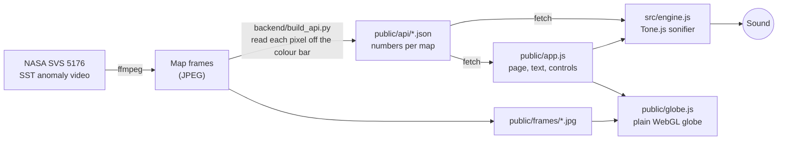

# Earth Jukebox

**Listen to NASA's ocean temperature maps.** Earth Jukebox turns NASA sea surface
temperature maps into music in your browser. Warmer than normal sounds higher,
colder sounds lower, and the ocean plays from your left ear (west) to your right (east).
A 3D globe shows what you are hearing, but you never need it: everything works by
ear and by keyboard alone.

Built for **NASA Space Apps 2026: The Earth Information Jukebox**.

## Why

Climate data is almost always a picture: a coloured map, a chart, a globe. For a
blind or low-vision person, the picture says nothing. Earth Jukebox makes the same
NASA data something you can hear, with every sound standing for a real number in the
map and nothing added for decoration.

## What you can do

| | |
| --- | --- |
| **Learn the sounds** | One minute of example buttons: warm, cold, land, a new map, the El Niño bell. |
| **Listen to a track** | **A1 Ocean Fever**: 31 monthly maps, May 2024 to Nov 2026. **A2 El Niño: then vs now**: the same day in 2025 and 2026, back to back. |
| **Two ways to hear a map** | *Scan*: 16 notes sweep west to east. *Planet Chord*: the whole ocean as one chord that gets rougher as it warms. *Strict mode*: plain tones at the exact pitch. |
| **Year by year, 1880 to 2025** | The whole planet as one sound. A sine wave's pitch is global temperature (350 Hz at the 1880–1900 average, +160 Hz per degree), a buzz at 880 Hz sounds in years at 1.5 °C or more, CO₂ makes the tone brighter, and shrinking Arctic sea ice makes the wind louder. Press Play or scrub the slider; it glides with no clicks. |
| **Hear the change** | Pick two dates and hear A, then B, with a plain-language list of what changed. |
| **Listen to one spot** | Tap the globe or the map, move two sliders, or jump to a place (Niño 3.4, Gulf Stream, the sea beside Tokyo...). It plays that 10° square and says its temperature. |
| **El Niño bell** | Rings when the Niño 3.4 box is warmer than the tropics by more than the El Niño line. |
| **Save as WAV** | Download one pass of a track with your mixer settings. |

Accessibility is the point, not an add-on: native HTML controls, keyboard only, one
live region that speaks only when you ask, an optional device voice for listeners
without a screen reader, mono mode, reduced motion, a flat map when WebGL is
missing, and 44 px touch targets from 320 px phones to desktops.

## Run it

The repository already contains the processed NASA data and the built audio engine,
so the website runs with only Python (any version from 3.10):

```bash
git clone https://github.com/atuuuuuuu/earth-jukebox.git
cd earth-jukebox
python3 scripts/serve.py 8000
```

Open <http://localhost:8000>, put on headphones, press **Start listening**, then **Play**.
With a keyboard: press Tab until Play has focus, then Space.

Browsers only allow sound after a click or key press, so nothing plays on page load.
On an iPhone, turn the silent switch off: iOS mutes web audio in silent mode.

## Develop and test

You need Node 20+ and Python 3.10+.

```bash
npm install                       # Tone.js, esbuild, Playwright, axe-core
npm run build                     # bundle src/engine.js into public/bundle.js
npm run validate                  # check public/api against backend/API.md: prints "API OK"
npm test                          # browser test: keyboard play, audio level, globe, year by year, axe accessibility
npm run test:responsive           # 320 to 1440 px: no sideways scroll, no overlaps, touch targets >= 44 px

pip install numpy scipy opencv-python-headless
npm run test:backend              # 17 backend tests with known answers
```

The browser tests need Chromium (`npx playwright install chromium`). Where Playwright
has no build for your OS, they use your installed Google Chrome instead.
`npm run test:responsive -- /tmp/shots` also saves screenshots of each section at each width.

## How it works



1. **Backend (Python, run once).** NASA publishes the maps as a video. ffmpeg
   extracts the frames, and `backend/analyze.py` reads every pixel's colour against
   NASA's own colour bar to get the temperature anomaly in °C. For each map it writes
   16 west-to-east strip averages, an 18 × 36 grid, the map average, the hot area,
   and the Niño 3.4 value relative to the tropics.
2. **The API is static JSON.** No server and no database: the site runs from plain
   files on GitHub Pages. `backend/API.md` is the contract between the two halves,
   and `npm run validate` enforces it.
3. **Frontend (plain JavaScript).** `src/engine.js` turns each map into notes with
   Tone.js. `public/app.js` drives the page and `public/globe.js` draws the globe in
   about 450 lines of WebGL.

### Year by year

`public/data/climate.json` joins three yearly records: NASA GISTEMP v4 global temperature
(1880 onward), NOAA's Mauna Loa CO₂ (1959 onward) and NSIDC's September Arctic sea ice
extent (1979 onward). `npm run climate` downloads them again and rebuilds the file.
GISTEMP is published against 1951–1980; the script moves it onto 1880–1900 so the
1.5 °C alarm means what the Paris Agreement means. Before a record starts, its sound is
silent and the page says so: nothing is filled in.

Each voice glides to the new year with `setTargetAtTime` (time constant 0.03 s), so
dragging the slider fast never clicks.

## Design decisions

- **One fixed scale per track.** A note means the same temperature in every map, so
  you can hear change over time. The scale is never stretched to fit one map.
- **Temperature anomaly, not temperature.** The maps show how far each spot is from
  its normal for that place and time of year, which is what makes warming audible.
- **Niño 3.4 relative to the tropics** (NOAA's relative index), so the bell follows
  El Niño itself, not the warming of the whole ocean.
- **No framework.** Plain HTML, CSS and JavaScript keep the page light on phones and
  every control a native, screen-reader-friendly element.
- **The globe never shows anything the sound and text do not.** The scan strip, the
  cursor box and the Niño 3.4 box all come from the score, and the flat map and text
  carry the same information.

## Project layout

```
public/      the website (deployed as is)
  index.html, styles.css, app.js, globe.js
  bundle.js  built from src/engine.js (committed so a fresh clone runs)
  api/       generated JSON: tracks.json and one score per track
  frames/    generated map images, 1024 × 512
  textures/  NASA Blue Marble for the land on the globe
  data/      climate.json: yearly temperature, CO₂ and sea ice (Year by year)
src/         engine.js: the Tone.js sonifier
backend/     Python: NASA frames to the JSON API (see backend/README.md, backend/API.md)
test/        run.cjs (browser + axe), responsive.cjs (layouts), ACCESSIBILITY.md (10-minute test with a screen reader user)
scripts/     serve.py (no-cache local server), climate_data.py (builds public/data/climate.json), roughness.py (checks the chord ladder)
AGENTS.md    rules for AI coding assistants working in this repo
```

## Rebuild the data

The processed data is already in `public/`. To rebuild it from NASA's video, follow
"On the day: real NASA data" in [`backend/README.md`](backend/README.md) (needs
ffmpeg and a 338 MB download), then `npm run api && npm run validate`.

`npm run sample` builds a small API from synthetic maps for testing. It **replaces**
the real data in `public/api`; restore it with `git checkout public/api public/frames`.

## Data and credits

- Sea surface temperature anomaly: [NASA Scientific Visualization Studio, SVS 5176](https://svs.gsfc.nasa.gov/5176).
  Data: MUR SST v4.1, NASA JPL PO.DAAC.
- Year by year: [NASA GISTEMP v4](https://data.giss.nasa.gov/gistemp/), [NOAA GML Mauna Loa CO₂](https://gml.noaa.gov/ccgg/trends/data.html), [NSIDC Sea Ice Index v4](https://nsidc.org/data/g02135).
- Land on the globe: [NASA Visible Earth, Blue Marble](https://visibleearth.nasa.gov/collection/1484/blue-marble).
- Sound: [Tone.js](https://tonejs.github.io/).

Earth Jukebox is not an official NASA product.
